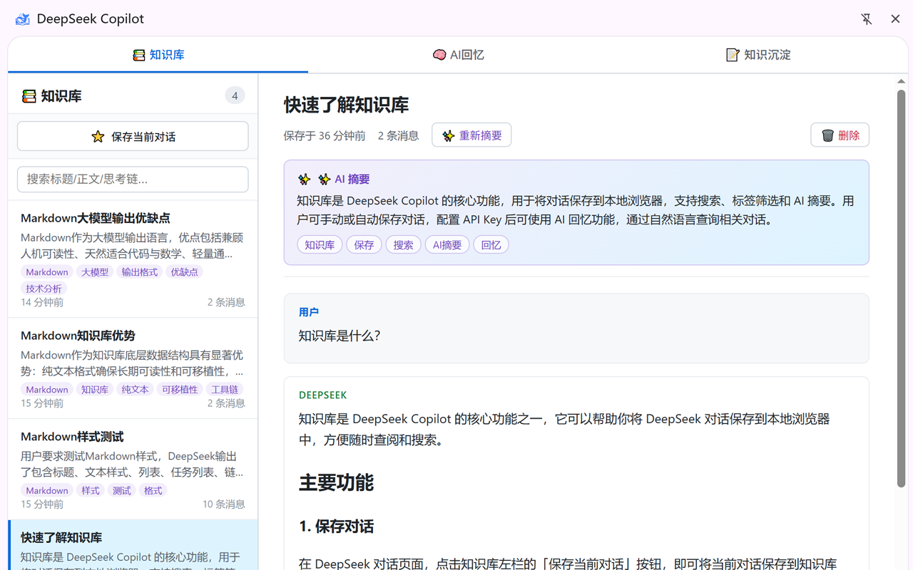
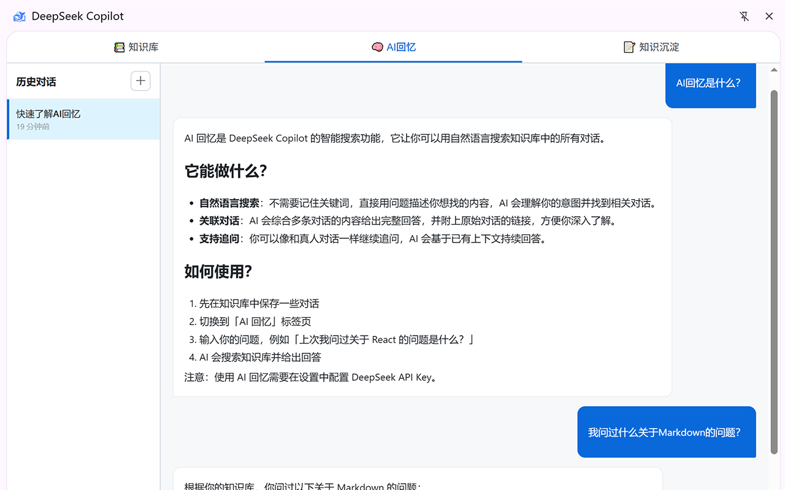
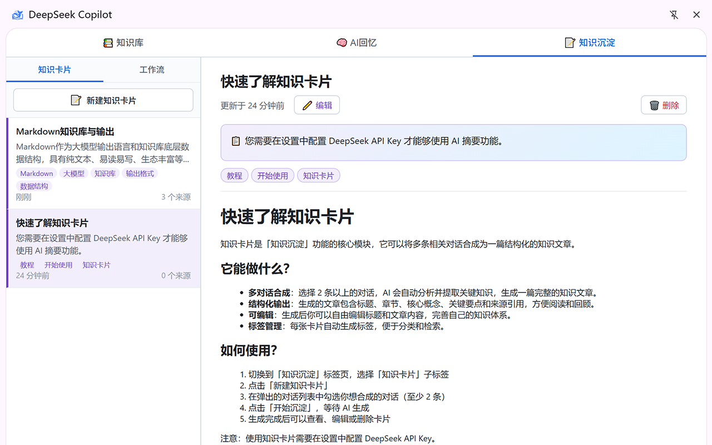
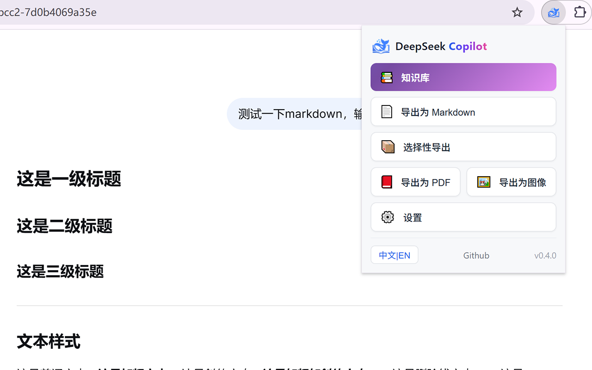

简体中文 | <a href="./README-en.md">English</a>

**DeepSeek Copilot** 是一款 Chrome 浏览器扩展，将 DeepSeek 对话变为你的**个人知识库**。一键导出对话为 Markdown / PDF / 图片，本地存储、AI 摘要、自然语言回忆、知识卡片与工作流沉淀——所有数据留在本地，自带 API Key 即可使用。

---

## 功能一览

### 导出对话

一键将 DeepSeek 对话导出为 **Markdown**、**PDF** 或 **图片**，支持选择性批量导出。

### 知识库

将对话保存到本地知识库，支持搜索浏览、AI 自动生成摘要与标签，也可开启自动保存。

### AI 回忆

用自然语言搜索你的知识库。AI 基于已有对话上下文流式回答，支持多轮追问，回复中引用的知识库对话可直接点击跳转。

### 知识沉淀

从多篇对话中提炼**知识卡片**（结构化文章）或**工作流**（可复用操作流程），让零散对话变成系统化知识。

### 快捷操作

通过 Popup 面板快速导出当前对话、打开知识库或进入设置。

---

## 核心特性

| 特性 | 说明 |
|---|---|
| 本地优先 | 所有数据存储在 IndexedDB，不上传任何后端 |
| BYOK 模式 | 自带 DeepSeek API Key，零成本零订阅 |
| API Key 加密 | AES-GCM-256 加密存储，安全可靠 |
| 自动保存 | 浏览对话时自动入库，无需手动操作 |
| 双语支持 | 中文 / English 界面切换 |
| 用量看板 | 追踪 API 调用次数、Token 用量与费用 |

---

## 安装

### 方法一：Chrome 商店安装（推荐）

直接从 [Chrome Web Store](https://chromewebstore.google.com/detail/deepseek2markdown/jfolcdbejlennfldgbninbjglbahaejn) 安装。

### 方法二：加载已解压的扩展

1. 打开 Chrome 浏览器，访问 `chrome://extensions/`，开启**开发者模式**
2. 点击「加载已解压的扩展程序」，选择项目中的 `src` 文件夹
3. 在扩展栏中固定插件

> **注意**：首次加载前如果已打开 DeepSeek 网页，请先刷新页面。

---

## 反馈与贡献

遇到问题或有改进建议，欢迎提交 [Issue](https://github.com/coderyjc/deepseek2markdown/issues) 或 PR。

## 致谢

[DeepSeek-Chat-Exporter](https://github.com/blueberrycongee/DeepSeek-Chat-Exporter)
